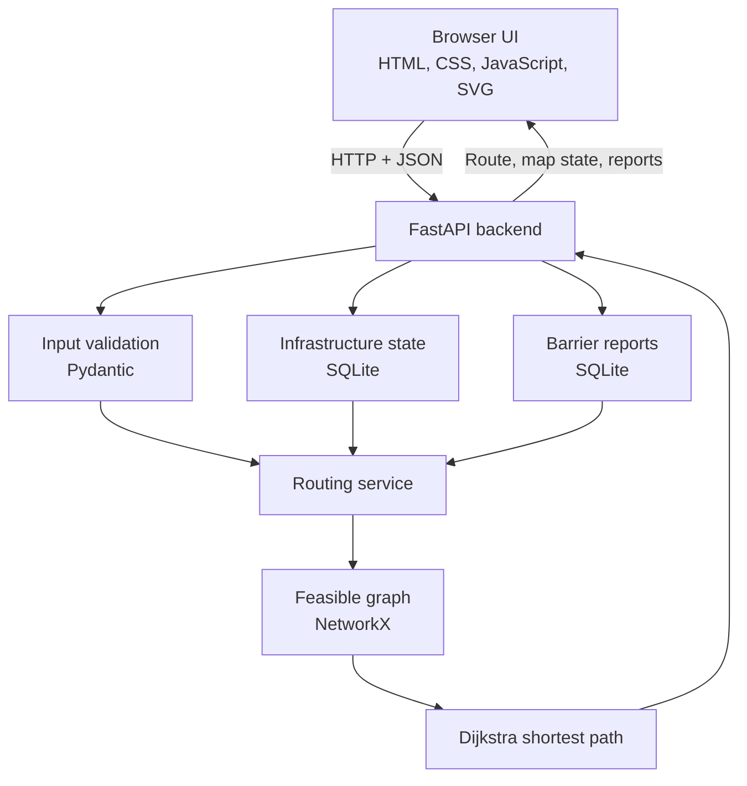

# AccessPath — Accessible Campus Navigation MVP

AccessPath is a small, local-first prototype for accessibility-aware campus navigation. It models a multi-level campus as a graph, applies user-specific accessibility constraints, finds a lowest-cost feasible route, and recalculates routes when an elevator or pathway becomes unavailable. Users can submit accessibility-barrier reports; an administrator can review those reports and verified reports become routing restrictions.

> **Prototype and safety notice:** The included campus, pathway measurements, accessibility profile thresholds, and route costs are illustrative demonstration data. They have not been surveyed or validated at a real campus. This software is not a certified navigation aid and must not be used as the sole basis for a real-world mobility or safety decision. The admin endpoints have no authentication or authorization. Run this prototype locally only; do not expose it to a public network.

## What the MVP demonstrates

- A graph containing **18 nodes** and **19 edges**, including outdoor paths, ramps, corridors, stairs, two elevators, and first-floor destinations.
- Three configurable demonstration profiles: manual wheelchair, cane/walker, and reduced walking endurance.
- **Hard accessibility constraints** (for example, stairs excluded for the wheelchair profile, and configured minimum-width / maximum-slope checks) applied before pathfinding.
- **Dijkstra routing** over the remaining feasible graph. The API returns physical route distance separately from its generalized route cost.
- Simulated administrator controls to mark elevators unavailable or path segments blocked.
- Dynamic route recalculation after infrastructure state changes.
- Barrier reports with pending, under-review, verified, rejected, and resolved states.
- Verified reports are applied as independent routing restrictions. Resolving a report removes only that report's restriction and does not overwrite an independent administrator-set maintenance outage or another active verified report.
- A **35-test** automated API/routing regression suite, plus a GitHub Actions workflow that runs the tests on Python 3.10, 3.11, 3.12, and 3.13.

## Example demonstration outcomes

The following distances are outputs from the **illustrative graph shipped in this repository**, not measurements of a real campus:

| Scenario | Expected result |
|---|---|
| Main Gate → Computer Science, manual wheelchair, both elevators available | Feasible route via E1; 169 m physical distance |
| Same request with E1 unavailable | Alternative route via E2; 183 m physical distance |
| Same request with both E1 and E2 unavailable | HTTP 422 with `NO_ACCESSIBLE_ROUTE`; no stair route is returned |
| E1 barrier report submitted but still pending | No routing change |
| E1 barrier report verified | E1 is excluded from routes |
| Verified E1 report resolved, with no other restrictions | The report-derived restriction is removed |

The selected route can differ when the start, destination, profile, or infrastructure state changes. Missing infrastructure-status records also fail closed and are not assumed operational.

## Architecture



### Request flow for route calculation

1. The user selects a start, destination, and accessibility profile in the browser.
2. `app/static/app.js` sends the selection to `POST /api/route` as JSON.
3. FastAPI validates the request with Pydantic.
4. The backend reads the current infrastructure and verified-report state from SQLite.
5. It excludes segments that are blocked, attached to unavailable facilities, covered by an active verified barrier report, or incompatible with the selected profile's hard constraints.
6. NetworkX runs Dijkstra on the remaining graph using generalized edge costs.
7. The backend returns the selected node and edge sequence, physical distance, generalized cost, and a status message.
8. JavaScript updates the route details and highlights the route in the SVG map.

### Routing model

An edge stores its two endpoint nodes and attributes such as physical distance, segment type, width, slope, surface, step presence, and optional facility ID.

The router applies hard constraints first. For example, the manual-wheelchair profile excludes stairs, edges narrower than its configured minimum width, and edges exceeding its configured maximum slope. Only feasible edges are added to the graph used by Dijkstra. Missing width or slope measurements are treated as unknown and excluded rather than assumed safe.

Among feasible paths, the algorithm minimizes a generalized cost. Cost multipliers and elevator surcharges in this demo are heuristic placeholders, not measured travel time or a clinical estimate of physical effort. The API reports the sum of actual segment distances separately as `distance_m`.

### Infrastructure state and reports

Direct administrator maintenance state is stored in `edge_state` and `facility_state`. Barrier reports are stored independently in `reports`. A segment is treated as unavailable if its direct admin status is blocked, it is covered by a verified edge report, or it depends on a facility that is manually unavailable or has an active verified facility report.

This separation prevents resolving one report from accidentally clearing an independent maintenance outage. Multiple verified reports against the same target remain effective until all of them are resolved through the allowed workflow.

## Repository structure

```text
accesspath-mvp/
├── .github/
│   └── workflows/
│       └── tests.yml          # GitHub Actions test workflow
├── app/
│   ├── __init__.py
│   ├── main.py                # Graph data, routing, SQLite, and FastAPI endpoints
│   └── static/
│       ├── app.js             # UI state, API calls, SVG rendering
│       ├── index.html         # Browser interface
│       └── styles.css         # Interface styling
├── data/
│   └── .gitkeep               # Local SQLite database is created here
├── tests/
│   ├── conftest.py            # Isolated temporary database per test
│   └── test_routing.py        # API and routing regression tests
├── .editorconfig
├── .gitattributes
├── .gitignore
├── CONTRIBUTING.md
├── README.md
├── SECURITY.md
├── pyproject.toml
├── requirements-dev.txt
├── requirements.txt
└── run_windows.bat
```

## Requirements

- Python **3.10 or later**
- Internet access for the initial Python package installation only
- A modern browser
- Git is recommended for repository development

The application uses a plain HTML/CSS/JavaScript frontend. It does not require Node.js, React, a frontend build step, a map API key, or internet access while running locally.

## Run on Windows

Open PowerShell in the extracted repository folder.

```powershell
py --version
py -m venv .venv
```

### Recommended: run the virtual-environment interpreter directly

This avoids PowerShell execution-policy problems with `Activate.ps1`:

```powershell
.\.venv\Scripts\python.exe -m pip install -r requirements.txt
.\.venv\Scripts\python.exe -m uvicorn app.main:app --reload
```

### Alternative: activate the environment in the current PowerShell process

If you want the `(.venv)` prompt, use a temporary process-scoped policy change:

```powershell
Set-ExecutionPolicy -Scope Process -ExecutionPolicy Bypass
.\.venv\Scripts\Activate.ps1
python -m pip install -r requirements.txt
python -m uvicorn app.main:app --reload
```

The policy change applies only to that PowerShell process. You do not need to change the machine-wide execution policy.

You can also double-click `run_windows.bat` from File Explorer. It creates `.venv` if needed, installs runtime dependencies, and starts the server.

## Run on macOS / Linux

```bash
python3 -m venv .venv
source .venv/bin/activate
python -m pip install -r requirements.txt
python -m uvicorn app.main:app --reload
```

## Open the application

- Browser UI: <http://127.0.0.1:8000>
- Interactive API documentation: <http://127.0.0.1:8000/docs>
- Health check: <http://127.0.0.1:8000/health>

Stop the server with `Ctrl+C` in the terminal.

## Demo walkthrough

1. Open the app. The default request is Main Gate → Computer Science with the manual-wheelchair profile.
2. Confirm the route avoids the staircase edge and uses E1.
3. In the facilities panel, select E1 and set its admin maintenance status to **Unavailable**. The route should recalculate through E2.
4. Set E1 to **Available** again. Select E2 and set it to **Unavailable**. The route should use E1.
5. Set both E1 and E2 to **Unavailable**. The wheelchair request to Computer Science should display a no-feasible-route error rather than use stairs.
6. Restore both elevators to **Available**.
7. Submit a barrier report for E1. It remains pending and does not affect routing.
8. In the review queue, click **Verify & apply**. E1 becomes unavailable to the routing engine and the route should use E2.
9. Click **Resolve**. The report-derived restriction is removed. The independent admin maintenance status is preserved.
10. Select a path segment in the SVG map or segment selector, mark it blocked, and calculate a route again to observe corridor rerouting.

The **Refresh map state** button reloads the latest server state. This MVP does not use WebSockets, browser push notifications, or continuous location tracking.

## API reference

| Method | Endpoint | Purpose |
|---|---|---|
| `GET` | `/` | Serve the browser interface |
| `GET` | `/health` | Check API and database availability |
| `GET` | `/api/map` | Return nodes, edges, effective status, profiles, facilities, and reports |
| `POST` | `/api/route` | Calculate a route from `start`, `destination`, and `profile` |
| `POST` | `/api/admin/facilities/{facility_id}/status` | Set manual facility status to `available` or `unavailable` |
| `POST` | `/api/admin/edges/{edge_id}/status` | Set manual edge status to `open` or `blocked` |
| `POST` | `/api/reports` | Submit a report against exactly one edge or facility |
| `POST` | `/api/reports/{report_id}/review` | Review a report using an allowed state transition |

Example route request:

```json
{
  "start": "GATE",
  "destination": "CS_DEPT",
  "profile": "wheelchair"
}
```

Example report request:

```json
{
  "facility_id": "E1",
  "barrier_type": "Elevator unavailable",
  "description": "Elevator is not responding.",
  "reporter_alias": "Student"
}
```

The report must identify exactly one target: `edge_id` or `facility_id`.

### Report state transitions

- `pending` → `under_review`, `verified`, or `rejected`
- `under_review` → `verified` or `rejected`
- `verified` → `resolved`
- `rejected` and `resolved` are terminal states

Invalid transitions return HTTP `409`. Unknown report IDs return `404`.

## Run the test suite

Install the development dependencies:

```powershell
# Windows PowerShell; use the venv interpreter directly if activation is blocked
.\.venv\Scripts\python.exe -m pip install -r requirements-dev.txt
.\.venv\Scripts\python.exe -m pytest -q
```

On macOS / Linux, after activating `.venv`:

```bash
python -m pip install -r requirements-dev.txt
python -m pytest -q
```

The tests use a **fresh temporary SQLite database per test**, so test order does not depend on a developer's local demo state. They cover the baseline wheelchair route, profile behavior, elevator failure and alternative routing, no-route handling, blocked segments, report verification and resolution, multiple reports, preservation of manual maintenance outages, invalid inputs, and key browser assets.

## Local data and reset

By default, the application creates `data/accesspath.db`. This database is intentionally excluded from Git.

To use another database file, set `ACCESSPATH_DB_PATH` before starting the app. For example, in PowerShell:

```powershell
$env:ACCESSPATH_DB_PATH = ".\data\my-demo.db"
.\.venv\Scripts\python.exe -m uvicorn app.main:app --reload
```

To reset the demo, stop the server and delete `data/accesspath.db`. Restarting the app recreates the database with open path segments and available elevators. This also deletes local barrier reports. Do not delete a database containing data you need to retain.

## Known limitations and next steps

- **Schematic map:** The graph is manually defined in `app/main.py`. Replace it with a measured map of a real campus before making real-world accessibility claims.
- **Undirected routing:** The graph uses an undirected `networkx.Graph`. Real buildings may need directional connections, access-control rules, opening hours, and one-way passage modeling.
- **Illustrative accessibility values:** Width and slope thresholds are sample configuration values. Real values and route suitability require physical audit, relevant standards review, and testing with people who have mobility limitations.
- **Heuristic costs:** Ramp, stair, surface, and elevator costs are demonstrative. They are not measured travel times or individualized exertion models.
- **No positioning:** The app does not determine a user's GPS or indoor position and does not provide continuous turn-by-turn guidance.
- **Simulated facilities:** Elevator status is changed manually in the admin interface. There is no connection to elevator controllers or facilities-management systems.
- **Manual refresh:** Other clients do not receive push updates. Users must refresh the map state to fetch changes made elsewhere.
- **No authentication:** Admin controls are open. Add authentication, role-based authorization, rate limiting, audit logging, and secure deployment controls before any networked use.
- **Local SQLite:** Appropriate for a single-machine prototype, not a multi-user campus service. A deployed system should consider PostgreSQL and transactional/concurrency requirements.
- **Report governance:** Duplicate grouping, reporter reputation, evidence review, expiry/re-verification, and conflict resolution need a clearly designed policy.
- **Accessibility validation:** A route that satisfies recorded graph attributes is not automatically safe or accessible in reality. Map data quality and user testing are essential.

## GitHub publication notes

Before publishing, review this README and the demonstration data, confirm the repository name and ownership, and choose a license if you intend to permit reuse. No license has been included because the project owner has not selected one. Never commit `.venv`, local databases, credentials, or real users' personal information.

The GitHub Actions workflow in `.github/workflows/tests.yml` runs the automated tests on pushes and pull requests.

To publish this folder as a new GitHub repository, create an empty repository on GitHub (do not add a README there), then run these commands from this folder after reviewing `git status`:

```bash
git init
git add .
git status
git commit -m "Prepare AccessPath MVP for initial release"
git branch -M main
git remote add origin https://github.com/<your-account>/<repository-name>.git
git push -u origin main
```

Replace the remote URL with your repository URL. These commands publish the source; they do not configure deployment or make the prototype production-safe.
